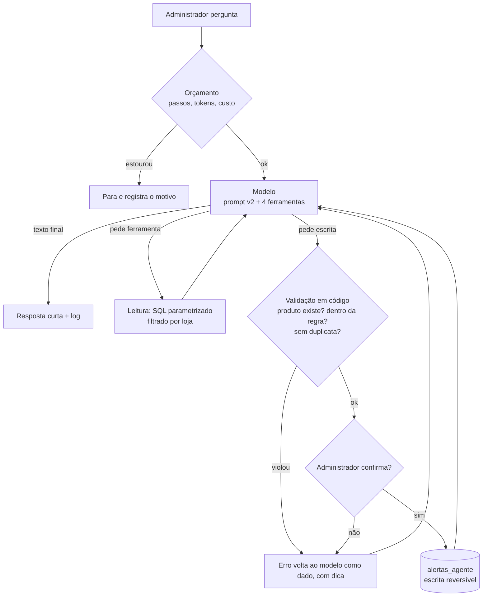

# Hydra: agente de IA para controle de estoque de pequenos mercados


-F55036)


Projeto em grupo da disciplina **IA Aplicada com LLMs e Agentes** (Centro Universitário Senac), construído sobre o **Sistema Hydra**, o PDV com controle de estoque que desenvolvemos como TCC ([repositório do TCC](https://github.com/AlefKaique/TCC--Senac---Sistemas-de-Informa-o)).

> **O problema:** o dono de um mercado de bairro não consegue perguntar ao sistema o que vence, o que está acabando ou o que está parado, e não tem onde registrar o que decidiu acompanhar.

O agente responde em português, consultando o banco por ferramentas, confere o que o Administrador afirma contra o dado real e, só quando ele pede e confirma, registra alertas de validade ou de estoque baixo.

```text
Administrador: O Leite Integral 1L está com uns 200 litros em estoque, então não preciso repor, certo?
  [passo 1] consultar_estoque({"produto": "Leite Integral 1L"}) -> 1 linha(s)
Assistente: - Leite Integral 1L: 6 un
            O estoque real é 6 unidades, abaixo do mínimo (20). O valor de "200 litros" informado não corresponde ao dado do sistema.
```

```text
Administrador: Registre um alerta de validade para o Arroz Tipo 1 5kg.
  [passo 3] registrar_alerta({"codigo_lote": "L-ARR-01", ...}) -> ERRO fora_da_regra
Assistente: O lote L-ARR-01 vence em 200 dias. Alertas de validade só podem ser registrados para lotes que vencem
            em até 30 dias ou já estão vencidos. Portanto, não foi possível registrar o alerta.
```

O segundo diálogo mostra a ideia central do projeto: **o modelo decide o que consultar; o código decide o que pode ser gravado.**

---

## Resultados

| Métrica | Prompt v1 | Prompt v2 |
|---|---|---|
| Casos rotulados que passaram | 3 de 5 | **5 de 5** |
| Alertas indevidos gravados no banco | 0 | **0** |
| Custo medido por pergunta (2 chamadas, 2.559 tokens) | | entre US$ 0,0004 e US$ 0,0015 |

Na v1, em 2 casos o modelo perguntava "quantos dias?" em vez de consultar o dado. A v2 corrigiu isso mudando três regras do prompt. **Ressalva honesta:** a v2 foi ajustada olhando os mesmos 5 casos, então o resultado prova que corrigiu o erro, não que generaliza. A meta da próxima etapa é 18 de 20 num conjunto maior.

---

## Como o agente funciona



**Quem decide cada passo:** das 8 etapas do workflow, só duas são do modelo (planejar as consultas e analisar o resultado). As demais são do código ou do humano.

| Garantia | Onde vive | Depende do modelo? |
|---|---|---|
| SQL só com parâmetros; ordenação por enum validado | `src/ferramentas.py` | não |
| Toda consulta filtrada por loja | `src/ferramentas.py` | não |
| Alerta de validade só para lote que vence em até 30 dias | `_preparar_alerta` | não |
| Confirmação humana antes de toda escrita | `src/agente.py` | não |
| Teto de 8 passos, 20 mil tokens e US$ 0,05 por pergunta | `src/agente.py` | não |
| Não inventar número; contradizer o usuário com o dado; recusar alterar estoque | `prompts/sistema_v2.md` | **sim**, e por isso é medido pelos casos |

### Ferramentas

| Ferramenta | O que faz | Tipo |
|---|---|---|
| `consultar_vendas` | ranking de mais vendidos ou parados nos últimos N dias | leitura |
| `consultar_estoque` | saldo por produto ou lista abaixo do mínimo | leitura |
| `consultar_validade` | lotes com saldo que vencem em até N dias (inclui vencidos) | leitura |
| `registrar_alerta` | cria alerta na fila do Administrador | **escrita reversível** |

---

## Técnicas e conceitos aplicados

| Aula | Conceito | Onde aparece |
|---|---|---|
| Agentes e casos de uso | **Espectro de autonomia**: por que agente e não *workflow* fixo ou roteador. O roteador não encadeia (o código do lote só existe depois da consulta de validade). E o risco do anti-padrão "resolve com formulário, SQL e três `if`", com plano B. | [`docs/case.md`](docs/case.md) |
| Escolha de modelos | Comparação de 3 candidatos (gpt-oss-120b, gpt-oss-20b, Mistral Small) pelos eixos que decidem **neste caso**, a conta de custo por execução e as condições em que mudaríamos de ideia. | [`docs/modelos.md`](docs/modelos.md) |
| Configuração da chamada | `temperature = 0` (configurável, porque alguns modelos de raciocínio rejeitam o parâmetro) e **carimbo de versão**: o log grava prompt (versão + sha), modelo e temperatura no início de cada execução. | [`src/config.py`](src/config.py) |
| Prompt engineering | **Prompt como código**: versionado, com cabeçalho de técnica, contrato de saída e motivo da mudança. Regra de ouro: *se apagar uma frase e não souber o que ela impedia, ela não fazia nada*. Cada regra tem o erro que impede. | [`prompts/`](prompts/) |
| Tool calling | Laço de ferramentas com **erro como dado**: o erro volta ao modelo com `detalhe` e `dica`, e ele corrige no máximo uma vez. | [`src/agente.py`](src/agente.py) |
| Arquitetura e confiabilidade | Orçamento em passos, tokens e custo; motivo de terminação sempre registrado (`resposta_final`, `orcamento_*`, `erro_llm`); *human-in-the-loop* antes de escrever. | [`docs/arquitetura.md`](docs/arquitetura.md) |
| Embeddings e RAG | Plano da base de conhecimento: o que o modelo **não** sabe (regras privadas e recentes do Hydra), o que **não** vai para o índice, o que vira **SQL** e não busca por similaridade, *chunking* por tipo de documento com metadados, e por que **não** usar banco vetorial nessa escala. | [`docs/base-de-conhecimento-v1.md`](docs/base-de-conhecimento-v1.md) |
| Avaliação (evals) | **Golden dataset** versionado, propriedades por nível (determinístico, trajetória, resultado), três **juízes LLM** com rubrica binária, validação do juiz contra dois rotuladores humanos independentes e a regra que separa melhora de acaso. | [`avaliacao/`](avaliacao/aula-11-avaliacao.md) |
| Segurança | Os **10 riscos do OWASP Top 10 para aplicações agênticas** (ASI01 a ASI10) aplicados ao case, os canais de entrada de conteúdo não confiável, a **trifecta letal** e um **risco aceito** documentado, com o que o limita e quando reavaliar. | [`seguranca/`](seguranca/aula14-riscos.md) |

### Avaliação no código

- `python -m src.avaliar` roda os casos rotulados e confere fatos objetivos: o **estado final do banco** (o conjunto exato de alertas), quais ferramentas foram e não foram chamadas, o motivo de parada e os números que precisam vir dos dados.
- Os casos difíceis estão nomeados nos dados simulados: a divergência (diz 200, o banco tem 6), o produto inexistente, o lote fora da janela, o pedido proibido (zerar estoque), um lote vencido com saldo e uma segunda loja com o mesmo produto.
- `tests/` tem 51 testes unitários do laço, das ferramentas e dos scripts de comparação.
- `logs/` guarda as trajetórias completas das execuções com o prompt v1 e o v2, para comparar.

---

## Minha contribuição

Sou **Maria Eduarda Leonardo De Souza** e participei das duas frentes do projeto.

No **agente** (disciplina de LLMs):

- **Case e justificativa de negócio** ([`docs/case.md`](docs/case.md)): o problema, os perfis de usuário, as regras de domínio, os casos difíceis, o ganho esperado e o maior risco do projeto com o plano B.
- **Arquitetura e workflow** ([`docs/arquitetura.md`](docs/arquitetura.md)): quem decide em cada passo, as ferramentas e a separação entre o que é regra do código e o que é escolha do modelo.
- **Prompts de sistema v1 e v2** ([`prompts/`](prompts/)): as regras, o formato de saída e a evolução de 3 de 5 para 5 de 5 casos.
- **Base de conhecimento para RAG** ([`docs/base-de-conhecimento-v1.md`](docs/base-de-conhecimento-v1.md)): o mapeamento das fontes, o que entra e o que fica de fora do índice e a estratégia de *chunking*.
- **Análise de segurança** ([`seguranca/aula14-riscos.md`](seguranca/aula14-riscos.md)): os dez riscos do OWASP agêntico no case e o risco aceito.

No **TCC (Sistema Hydra)**:

- **Responsável pela documentação técnica** do sistema: regras de negócio, requisitos, descrição das telas, Termo de Uso e Política de Privacidade. É a mesma documentação que serve de fonte para a base de conhecimento do agente.
- **Apoio na formulação e na construção do front-end** (`Hydra.Front`).

### O que aprendi

- **Agente só onde o agente se paga.** As 4 perguntas-padrão do chat seriam melhor resolvidas por telas fixas. Escrever isso no próprio case, com um plano B, foi mais útil do que defender o agente a qualquer custo.
- **O modelo propõe, o código dispõe.** Tudo o que pode ser verificado (regra de validade, filtro por loja, duplicata, orçamento) fica no código. O prompt só garante o que não dá para garantir de outra forma, e isso é medido, não assumido.
- **Um erro de comportamento se corrige no prompt, mas se descobre na avaliação.** A falha da v1 ("quantos dias?") só apareceu porque havia casos rotulados conferindo quais ferramentas foram chamadas.
- **Avaliar o juiz antes de confiar nele.** Um juiz que sempre diz "fiel" teria mais de 85% de concordância sem medir nada. Por isso a validação pede casos negativos e dois rotuladores humanos independentes.
- **Segurança é arquitetura.** O nome de um produto é conteúdo não confiável. A defesa mais barata não foi um filtro, foi não dar ao agente nenhuma forma de comunicação para fora.
- **RAG não é para tudo.** Saldo e validade são consulta SQL; regra de negócio é busca com metadado; o que o modelo já sabe não entra no índice.

---

## Como executar

Precisa de Python 3.10 ou mais novo e de uma chave de um provedor compatível com a biblioteca `openai` (o grupo testou com o Groq, plano gratuito).

```bash
python -m venv .venv
.venv\Scripts\activate            # Windows   (Linux/macOS: source .venv/bin/activate)
pip install -r requirements.txt
copy .env.example .env            # Windows   (Linux/macOS: cp .env.example .env)
```

Preencha no `.env`: `LLM_BASE_URL=https://api.groq.com/openai/v1`, `OPENAI_API_KEY` e `LLM_MODEL=openai/gpt-oss-120b`. Depois:

```bash
python -m src.main "Quais produtos estão abaixo do estoque mínimo?"   # uma pergunta
python -m src.main                                                   # modo interativo
python -m src.avaliar                                                # roda os casos rotulados
python -m unittest discover tests                                    # testes
```

O banco simulado (`dados/hydra_demo.db`) é criado na primeira execução a partir de `dados/schema.sql` e `dados/seed.sql`. Nenhuma chave vai para o git.

## Estrutura

```text
src/          agente (laço), ferramentas, configuração, avaliação, baseline e comparação de modelos
prompts/      prompt de sistema v1 e v2, versionados
dados/        schema e seed do banco simulado, casos rotulados e candidatos a modelo
logs/         trajetórias das execuções (v1 em logs/v1/)
tests/        testes unitários
docs/         case, arquitetura, modelos, base de conhecimento e fontes
avaliacao/    plano de avaliação (aula 11)
seguranca/    análise de riscos OWASP agêntico (aula 14)
```

Alguns documentos citam arquivos do sistema completo (`Hydra.Front`, `Hydra.Back`, `Hydra.Agent`). A versão atualizada do sistema (front-end, back-end e documentação técnica) está no [repositório do TCC](https://github.com/AlefKaique/TCC--Senac---Sistemas-de-Informa-o); o `Hydra.Agent` fica no repositório original da disciplina.

## Próximos passos

- Medir a linha de base de tempo (`python -m src.baseline`) e rodar a comparação dos 3 modelos (`python -m src.comparar`).
- Ampliar o golden dataset de 5 para 20 casos e implementar o juiz de fidelidade.
- Implementar o RAG sobre as regras de negócio e transformar a camada de banco em um servidor MCP.
- Decidir com o grupo se o agente entra no produto final do TCC.

## Equipe e créditos

| Integrante | GitHub |
|---|---|
| Alef Kaique Santos Almeida de Araujo | [@AlefKaique](https://github.com/AlefKaique) |
| Felipe Claudiano Synthes | [@BoruCode](https://github.com/BoruCode) |
| Maria Eduarda Leonardo De Souza | [@MariaEduardaSouza001](https://github.com/MariaEduardaSouza001) |

Este repositório reúne a parte do agente do projeto em grupo.

| Repositório | O que tem |
|---|---|
| [AlefKaique/TCC--Senac---Sistemas-de-Informa-o](https://github.com/AlefKaique/TCC--Senac---Sistemas-de-Informa-o) | **TCC atualizado: Sistema Hydra** (front-end, back-end) e a documentação técnica da entrega 2 |
| [BoruCode/PROJETOLLM.HYDRA](https://github.com/BoruCode/PROJETOLLM.HYDRA) | repositório original da disciplina de LLMs, com o histórico completo do agente | Material da disciplina: [celsocrivelaro/senac-agentes-llm](https://github.com/celsocrivelaro/senac-agentes-llm).

Licença MIT, mantida do projeto original ([`LICENSE`](LICENSE)).
